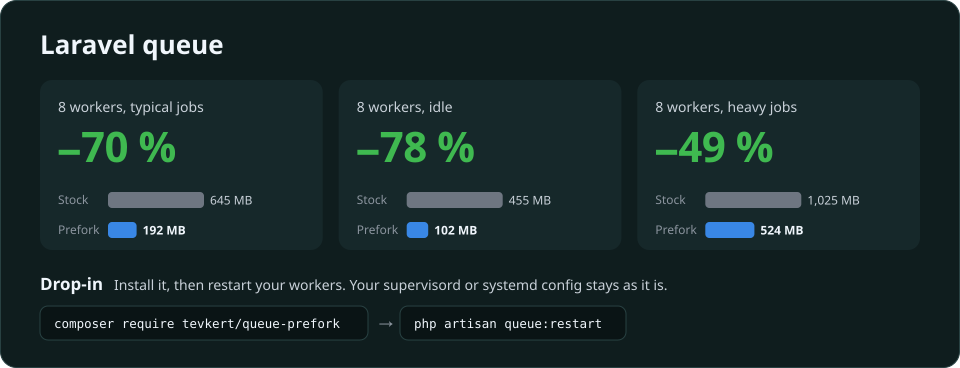
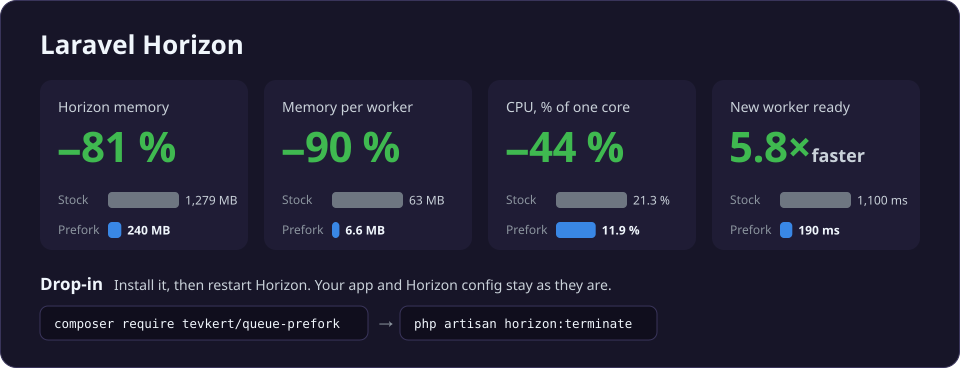

# Queue-prefork for Laravel queue and Horizon

**Cut the memory of Laravel queue workers by up to 80 %, for plain `queue:work` and Horizon. A drop-in package: no code changes, no new services.**





[Why](#why-queue-workers-use-so-much-memory) · [What it does](#what-queue-prefork-does) · [Requirements](#requirements) · [Install](#install) · [Laravel Cloud](#laravel-cloud) · [How it works](#how-it-works) · [Commands](#commands) · [FAQ](#faq) · [Configuration](#configuration) · [Benchmarks](#benchmarks) · [Limitations](#limitations-and-differences-from-stock) · [Troubleshooting](#troubleshooting) · [Development](#development) · [Security](#security)

Questions, bug reports, numbers from your app: [open an issue](https://github.com/tevkert/queue-prefork/issues), or find me on X at [@tevkert](https://x.com/tevkert).

## Why queue workers use so much memory

Every queue worker is a separate PHP process: each `queue:work`, and each Horizon worker and supervisor. Each one boots your whole Laravel app and compiles its code into its own private memory before it runs a single job. That's often 50–80 MB per process with a typical set of packages, and nearly all of it is the same in every process. On a small VPS, the queue workers are often the biggest thing on the server.

**With Horizon, supervisors cost almost as much as workers.** Splitting your queues into supervisors is like sorting files into folders: it keeps the work organised. Now imagine every folder taking as much disk space as a file. That's what Horizon does:
- in the benchmark below, each supervisor took 56 MB, close to a worker's 63 MB;
- a supervisor never runs a job; it only manages its workers;
- 6 supervisors cost about 340 MB just for the organisation.

## What queue-prefork does

Your workers start as forks of a small template process, so the compiled code lives once, in shared memory, for all of them. Your supervisord, systemd or Forge config stays as it is.

**What it doesn't do is fork your booted app.** The template never loads Laravel or your code. Each worker still boots your app itself, from its own entry script with the same command line, exactly as a stock worker does; only the compiled code is shared, through opcache. So a fork inherits nothing a booted app holds: no database or Redis connections, open sockets, singletons, resolved config or random seeds. Those are what make forking a booted app go wrong, with bugs like two workers talking over one connection or drawing the same "random" values. Queue-prefork avoids that whole class of problems by design.

**Memory by number of workers,** with typical jobs:

| Workers | Queue | Queue with prefork | | Horizon | Horizon with prefork |
|---:|---:|---:|---|---:|---:|
| 1 | 89 MB | 89 MB (±0 %) | | 202 MB | 114 MB (−44 %) |
| 2 | 168 MB | 104 MB (−38 %) | | 281 MB | 128 MB (−54 %) |
| 4 | 327 MB | 133 MB (−59 %) | | 440 MB | 158 MB (−64 %) |
| 8 | 645 MB | 192 MB (−70 %) | | 758 MB | 216 MB (−72 %) |
| 16 | 1.2 GB | 310 MB (−76 %) | | 1.4 GB | 338 MB (−77 %) |
| 32 | 2.5 GB | 545 MB (−79 %) | | 2.8 GB | 581 MB (−79 %) |
| 128 | 9.9 GB | 1.9 GB (−81 %) | | 10.9 GB | 2.0 GB (−82 %) |
| 512 | 39.7 GB | 7.4 GB (−81 %) | | 43.2 GB | 7.7 GB (−82 %) |

Worked out from the measured [benchmarks](#benchmarks): shared memory is counted once, plus each process's own memory. Both modes count the same long-running worker; Horizon adds its master and one supervisor per 8 workers. Each forked worker saves about 65 MB of compiled code here, and a single worker has nothing to share with.
- **Heavy jobs save less,** because a job's own data is private in both modes: −49 % for 8 `queue:work` workers and −77 % for Horizon with image processing, LLM calls and big renders. Idle workers save more: −78 %.
- **A Horizon supervisor costs about 6 MB instead of 56 MB,** so organising queues into more supervisors gets about nine times cheaper.
- **Throughput stays the same, and CPU use falls,** because a new worker doesn't recompile the app.

If any safety check fails, workers run exactly as stock and the package tells you why.

## Requirements

- Linux, for production. macOS works for local development; Windows always runs stock.
- PHP 8.2+ with `pcntl`, `posix` and opcache (PHP 8.3+ for Laravel 13).
- Laravel 11, 12 or 13.
- Workers started by a process manager: supervisord (Forge and Ploi daemons included), systemd, or an init such as `tini` in containers. A worker or Horizon master running as PID 1 runs stock.
- **For `queue:work`:** `/bin/sh`, and **FFI** for the CLI, so each worker's output stays in its own program's log. Most PHP builds ship it:

  | Platform | FFI |
  |---|---|
  | Debian, Ubuntu, Ondřej Surý's packages | shipped and enabled (`phpenmod -s cli ffi` if it was turned off) |
  | Fedora, RHEL and derivatives | `dnf install php-ffi` |
  | Alpine | `apk add php83-ffi` (your PHP version) |
  | Official Docker `php` images | `docker-php-ext-install ffi` (needs `libffi-dev`) |
  | macOS: Herd, Homebrew | shipped and enabled |
  | Laravel Cloud | not available, so the shared log is used ([see Laravel Cloud](#laravel-cloud)) |

  Without FFI, Linux workers still fork, with their output in a shared log ([see below](#plain-queuework)), and macOS workers run stock.
- **For Horizon:** Horizon 5.23 or newer, up to the newest tested minor (currently **5.50**).

## Install

```bash
composer require tevkert/queue-prefork
```

It's on as soon as it's installed. There's no service provider to register and nothing to change in your queue or Horizon config.

**Then, on a server your workers run on** (staging or production), after the deploy:

```bash
php artisan queue-prefork:doctor      # how your workers would run on this host, and why
php artisan queue-prefork:status      # your workers' memory before the restart: a stock baseline
php artisan queue:restart             # plain queue:work: your process manager starts them again
php artisan horizon:terminate         # Horizon
php artisan queue-prefork:status      # mode, templates and memory per process
```

Run the doctor where the workers run, as their user, with the same `php` options they start with. It checks that host's PHP, its extensions and limits, so on your laptop it only tells you about your laptop.

**In Docker,** a container whose command is `php artisan horizon` or `queue:work` runs it as PID 1, and PID 1 runs stock. Give the container an init:

```yaml
services:
  horizon:
    image: your-app
    command: php artisan horizon
    init: true        # Docker's tini becomes PID 1, and Horizon its child
```

`docker run --init` does the same, and so does `ENTRYPOINT ["tini", "--"]` in your image. Images that start supervisord or s6 already have one. Run the doctor inside the container (`docker compose exec horizon php artisan queue-prefork:doctor`); it reports when PID 1 is the worker itself. A container with a single `queue:work` saves nothing, since there's nothing to share: run several workers in one container, under supervisord, or use Horizon.

**To turn it off:**
- **For good:** set `QUEUE_PREFORK=false` in `.env`, or `QUEUE_PREFORK_QUEUE_WORK=false` or `QUEUE_PREFORK_HORIZON=false` for one mode. As with any setting, deploy, run `php artisan config:cache` if you cache your config, and restart your workers.
- **Quickly, without a deploy or re-cache:** `php artisan queue-prefork:switch disable` (add `--mode=queue-work` or `--mode=horizon` for one mode), then restart your workers. `queue-prefork:switch clear` hands the decision back to your config.

> [!IMPORTANT]
> **Your config is the permanent setting.** The switch is a quick override for one server. With Horizon it lives in Redis, per hostname, so a Redis flush or a new hostname (common in containers) drops it. Without Horizon it's an off file in `storage/framework`.

## Laravel Cloud

Horizon runs forked on Laravel Cloud's app and worker clusters, with one change. Cloud's PHP loads ext-grpc, which starts threads when PHP starts, so start Horizon as a custom background process with gRPC's fork support on:

```bash
php -d grpc.enable_fork_support=1 artisan horizon
```

- **Without the flag, Horizon runs stock,** and the doctor says why: `ext-grpc without grpc.enable_fork_support=1`. Run the doctor with the same flag, from Cloud's Commands tab: `php -d grpc.enable_fork_support=1 artisan queue-prefork:doctor`. Commands run on an app instance; worker clusters have the same runtime.
- **`queue:work`:** Cloud's built-in queue worker can't take PHP options, so use a custom background process, `php -d grpc.enable_fork_support=1 artisan queue:work …`. Cloud's PHP has no FFI, so the workers use the shared log: their console output (each job's RUNNING and DONE lines) goes to `storage/logs/queue-prefork-*.log` on the instance's disk instead of Cloud's logs. Your app's log entries still reach Cloud's logs. `QUEUE_PREFORK_OUTPUT=stock` keeps those workers stock instead.
- **Managed queues** run each worker in its own pod, so there's nothing to share. Queue-prefork is for Horizon or `queue:work` running on your own clusters.

**Measured on Cloud,** with a fresh Laravel 13 app and the same everyday job mix in both modes, 600 jobs a minute:

| Flex 2 GB instance, filled to ~90 % of its memory | Stock | Prefork |
|---|---:|---:|
| Horizon workers running | 27 | 198–210 |
| Memory per worker | ~56 MB | ~7–8 MB |
| CPU to start a worker | 0.51 s | 0.16 s |

- **Stock workers cost more on Cloud than elsewhere:** its CLI runs with `opcache.enable_cli` on, so every stock process compiles the app into its own private opcache.
- **210 stock workers needed a Pro 16 GB instance** (11.8 GB in use); with prefork they fit on the Flex 2 GB one.
- No job failed in either mode, on app and worker clusters alike.

## How it works


In both modes:
- **The template** loads no application code. It owns opcache's shared memory and forks workers on request.
- **Your process manager sees no difference.** The pid it started stays, takes the signals and exits the way the worker or master did; signals ignored under `nohup` stay ignored.

### Plain `queue:work`

Each `queue:work` process hands itself to a shared template before Laravel boots, and stays behind as a `/bin/sh` stub with the same pid (two shells of about 0.1 MB each).
- **Your supervisor's controls work as in stock:** `stop`, `restart`, `stopwaitsecs`, `queue:restart`, `USR2`/`CONT`, `--timeout` kills, `--max-time`, `--memory` and maintenance mode, each tested side by side with stock under supervisord and systemd.
- **Workers share a template** when they run the same release, PHP binary and settings, as the same user, and on Linux in the same cgroup. Under supervisord that's normally all your workers; under systemd each service has its own, so a unit per worker gains nothing.
- **Output:** with FFI, a worker's stdout and stderr are its stub's, so job lines land in the same program log or journald as before. Without FFI on Linux, they go to one rotated file per template, `storage/logs/queue-prefork-<host>-<key>.log`; if a log channel writes to stdout or stderr, workers run stock instead.
- **A worker runs stock** when it's PID 1 or given `--once` or `--stop-when-empty`, when a switch says so, while Blackfire profiles it, on macOS without FFI or with `php -d …`, and for 15 minutes after its template fails to start or keeps crashing.

### Horizon

- **On Linux, the pid your process manager started becomes the template** and forks the master. On macOS, and as a fallback on Linux, the master starts as before and spawns the template.
- **Each supervisor gets a small fork server** that forks the stock supervisor loop and its workers.
- **Horizon works as usual,** because supervisor and worker code is Horizon's own: the dashboard, `horizon:terminate`, `pause`, `continue`, `purge`, autoscaling, and supervisord's `stopasgroup` and `killasgroup`.
- **Fallbacks.** A failed check runs the stock master in the same pid. If the template dies on Linux, Horizon exits and your process manager restarts it. A supervisor whose workers keep dying before their first loop is replaced by a stock one; a supervisor and its workers are always all forked or all stock. Each fallback logs a `queue-prefork:` error line and fires an event.

### Fork safety

Before forking, a template audits itself: sockets, epoll, eventfd or extra threads that extensions open at startup mean stock workers. ddtrace, Elastic APM and gRPC with fork support (`grpc.enable_fork_support=1`, which rebuilds its threads and poller in each fork) are allowed; workers run stock with New Relic, gRPC without fork support, datadog-profiling and Blackfire.

### Deploys

A worker started after a deploy sees the new code, as a fresh stock process would. Deploy as usual and finish with `queue:restart` or `horizon:terminate`, which also covers upgrading this package. With zero-downtime deploys, each release gets its own template, and the old one exits a minute after its last worker.

## Commands

| Command | What it does |
|---|---|
| `queue-prefork:doctor [--json]` | How Horizon and `queue:work` would run on this host, and why: platform, PHP functions, FFI (with the install line for your platform), Horizon version and bindings, entry scripts, extensions. Warns about a low `kernel.pid_max` and APCu. Exits 1 if a check fails. |
| `queue-prefork:status [--json]` | The mode (`prefork`, `degraded` or `stock`, with the reason), the templates, and every worker process with its RSS, PSS and private memory (Linux). Exits 1 while anything runs stock, so it works as a monitoring check. |
| `queue-prefork:switch [enable\|disable\|clear\|show] [--mode=queue-work\|horizon] [--all]` | The runtime override of the switches ([see Install](#install)), applied at the next worker or Horizon start; `--all` covers every host. `show` prints each mode's state and where it comes from. |
| `queue-prefork:retire [--all]` | New `queue:work` workers start from a fresh template; the old one drains. `--all` covers every release of this user. |

Run them as the workers' user: `queue:work` templates live in that user's runtime directory (`$XDG_RUNTIME_DIR/qp-<uid>` or `/tmp/qp-<uid>`).

**Events (Horizon)** are string events `queue-prefork.<Name>` with one array argument: `PreforkStarted`, `PreforkUnavailable`, `UnitStock`, `UnitEnded`, `BreakerTripped`, `TemplateCrashed`, `TemplateHung`, `TemplateGone`, `TemplateLog`, `StatusUnknown`, `LoopKilled` and `SignalMisdirected`. To alert on fallbacks:

```php
Event::listen('queue-prefork.UnitStock', fn (array $context) => report(new RuntimeException(json_encode($context))));
```

## FAQ

**Do I need Horizon?** No. Plain `queue:work` under supervisord or systemd works on its own. With Horizon installed, both its workers and any plain `queue:work` workers are forked.

**Why not just turn on `opcache.enable_cli`?** Each separately started CLI process gets its own private opcache. That saves compile time inside one process but shares nothing between processes, and usually costs more memory overall. Sharing needs one opcache owner and forks.

**Octane, Pulse, Nightwatch, Telescope?** Octane isn't affected: only queue workers change. Pulse and Nightwatch ran throughout the benchmarks. Telescope boots in each worker as in stock.

## Configuration

Most apps need nothing. Every setting is a config key, most of them backed by an environment variable, like any Laravel setting: with a cached config, a change needs `php artisan config:cache` and a restart of your workers. To publish the file: `php artisan vendor:publish --tag=queue-prefork-config`.

The switches and template settings are needed before Laravel boots, so they're read early, the way Laravel will resolve them: from the cached config when there is one (`APP_CONFIG_CACHE` is honoured), else from the environment and the env file Laravel would load (`.env.<APP_ENV>` when it exists, else `.env`).
- **Without a cached config,** the early read follows the variables, not a published config file that hard-codes a value. `queue-prefork:doctor` warns when they differ, and `config:cache` fixes it.
- **A custom env file path** set with `loadEnvironmentFrom()` isn't followed.

**Switches,** on by default. Off means false as a boolean: `false`, `0` or empty.

| Variable | Config key | Turns off |
|---|---|---|
| `QUEUE_PREFORK` | `enabled` | everything: `queue:work` and Horizon run stock |
| `QUEUE_PREFORK_QUEUE_WORK` | `queue_work` | plain `queue:work` only |
| `QUEUE_PREFORK_HORIZON` | `horizon` | Horizon only: its master, supervisors and workers |

For a quick off on one host, without a re-cache, use `queue-prefork:switch disable [--mode=…]` or create `storage/framework/queue-prefork.off` (or `queue-prefork.off-queue-work`, `queue-prefork.off-horizon`).

**Template settings.** In the published config file, each variable feeds a key of its own, such as `opcache.memory_consumption`:

| Variable | Default | Meaning |
|---|---|---|
| `QUEUE_PREFORK_OPCACHE_MB` | 192 | MB of shared opcache per template, counted once. Raise it if opcache fills up. |
| `QUEUE_PREFORK_INTERNED_MB` | 32 | MB for interned strings. Package-heavy apps fill PHP's default 8 MB. |
| `QUEUE_PREFORK_MAX_FILES` | 20000 | The most scripts opcache can hold. |
| `QUEUE_PREFORK_ALLOW_DESCRIPTORS` | empty | Comma-separated `fnmatch` patterns (or an array) for descriptors a template may hold at startup, e.g. `socket*`. Only for extensions you know are fork-safe. |
| `QUEUE_PREFORK_THREAD_AUDIT` | `true` | On Linux, refuse a template that has extra threads at startup. |
| `QUEUE_PREFORK_WARMUP` | `true` | A fresh `queue:work` template boots your app once in a throwaway process, so the first workers fork warm. |
| `QUEUE_PREFORK_KILL_GROUP` | `true` | A killed stub takes its worker's process group with it; `false` kills the worker alone. |
| `QUEUE_PREFORK_LOG_MAX_MB` | 10 | Size at which the shared log rotates (`queue:work` on Linux without FFI). |
| `QUEUE_PREFORK_LOG_FILES` | 3 | Rotated shared logs kept. |
| `QUEUE_PREFORK_OUTPUT` | | `stock` runs those workers stock instead of using the shared log. |

`queue:work` workers with different values get different templates.

**Horizon timeouts and checks,** config keys only:

| Key | Default | Meaning |
|---|---|---|
| `template_timeout` | 5 | Seconds the master waits for its template to report ready. |
| `hello_timeout` | 15 | Seconds a new supervisor loop gets to boot before that supervisor goes stock. |
| `spawn_timeout` | 10 | Seconds before an unanswered request to a template or fork server counts as overdue. Pauses (swap, SIGSTOP, VM suspend) don't count. |
| `exit_grace` | 15 | Seconds a forked loop or worker gets for its shutdown code after its command finished. |
| `allow_untested_horizon` | `false` | Allow Horizon minors newer than the tested one. |
| `allow_unprofiled_workers` | `false` | Allow prefork with datadog-profiling on. Forked children aren't profiled. |

**The template's opcache settings are fixed:** `opcache.enable_cli=1`, `validate_timestamps=1`, `revalidate_freq=0` and `save_comments=1`, with preload and JIT off, whatever your `php.ini` says. Your web server's and other commands' opcache settings are untouched. An `auto_prepend_file` from your CLI ini runs once in every forked worker, as in a fresh process.

## Benchmarks

Two identical Docker stacks, stock and prefork, ran side by side on the same seeded job stream: tini, then supervisord set up like a Forge daemon, config cached, Horizon's `fast_termination` on, each in its own cgroup with swap off. Memory is the median PSS of all worker processes, sampled every minute from `/proc/<pid>/smaps_rollup`. PSS splits each shared page between the processes that map it, so it adds up to the real footprint; RSS would count the shared opcache once per process.

| Run | Stock | Prefork | CPU, % of one core | Jobs, stock / prefork |
|---|---:|---:|---:|---:|
| `queue:work`, 8 workers, typical jobs, 1 h | 645 MB | 192 MB (−70 %) | 12.0 → 11.0 | 27,730 / 27,730 |
| `queue:work`, 8 workers, heavy jobs, 1.75 h | 1,025 MB | 524 MB (−49 %) | 21.2 → 19.5 | 71,131 / 71,179 |
| `queue:work`, 8 workers, idle | 455 MB | 102 MB (−78 %) | | |
| `queue:work`, 4 workers, idle | 229 MB | 84 MB (−63 %) | | |
| Horizon, typical jobs, 1 h | 1,279 MB | 240 MB (−81 %) | 21.3 → 11.9 | 27,788 / 27,784 |
| Horizon, heavy jobs, 1 h | 1,543 MB | 351 MB (−77 %) | 32.4 → 21.4 | 40,594 / 40,623 |

No job failed, and every run's last hour was within a point of its median. Prefork's numbers include its templates, stubs and fork servers. Horizon ran 6 supervisors with autoscaled workers: with typical jobs, a median of 14 in stock and 17 forked.

**Job mixes.** Typical: about 450 jobs a minute, without bursts: 40 % notifications (database, mail to the log and web push), 30 % small Eloquent upserts of 5–20 rows, 20 % cache reads and 10 % short HTTP calls. Heavy: 650–680 jobs a minute, with bursts, across 8 queues: feed imports, image renditions, LLM calls, Livewire renders, notifications and sitemaps.

**The app** is Laravel 13.38 with about 45 production packages, among them Filament 5, Livewire 4 with Flux, Fortify, Nightwatch, Pulse, Scout, laravel/ai, Socialite, spatie's activitylog, health and sitemap, Intervention Image and the AWS SDK. Mail goes to the log; web push, HTTP and LLM calls go to local stubs. PHP 8.4 and Horizon 5.50.1 on a 2-CPU Linux VM (Docker Desktop); stock runs with CLI opcache off, as `php.ini-production` ships it.

**Spawn speed (Horizon).** From its process being created to its first loop, a new worker took 190 ms instead of 1.1 s at the median (p95: 440 ms instead of 2.3 s). While Horizon starts and all workers compete for CPU, it took 270 ms instead of 1.5 s (p95: 660 ms instead of 7.1 s). This was a separate 10-minute run with heavy jobs, before the master was forked, which doesn't change how workers start.

**Reproducing.** The harness is in this repository: `docker/`, `workbench/` and `soak/`. See [docker/README.md](docker/README.md); `soak/run.sh 2` runs both stacks for 2 hours and writes the report, and `SOAK_MIX=light` selects the typical jobs.

## Limitations and differences from stock

- **Kubernetes is untested.**
- **`ps` looks different.** A `queue:work` program's pid is `/bin/sh …/stub-<hash>.sh`, and its worker is a child of `php [qp-template:<key>]`. On Linux, Horizon's pid is `php [hp-template:host]`, with `php artisan horizon` as its child, and each supervisor has a fork server, whose pid `horizon:supervisors` shows.
- **If a `queue:work` template is killed,** its workers finish their jobs, but their programs then exit 1; your process manager restarts them on a new template. A worker killed by a core-dumping signal (SIGSEGV, SIGABRT) exits 128+n rather than "terminated by SIGSEGV".
- **`queue:work` in a terminal:** Ctrl-Z suspends only the stub, so the worker keeps taking jobs until `fg` or Ctrl-C. Under a process manager this never applies.
- **Tested Horizon minors only.** The package overrides a few Horizon internals (`AddSupervisor`, `SupervisorFactory`, `Supervisor` and `ProcessPool`), so a newer minor runs stock until a release raises the limit; `allow_untested_horizon` lifts the check at your own risk.
- **The forked Horizon master is Linux-only.** On macOS only supervisors and workers are forked.
- **Shared-memory extensions are shared by the whole tree,** as under PHP-FPM: APCu with `apc.enable_cli`, Relay and sysvshm.
- **Entry scripts must read arguments from `$_SERVER['argv']`,** not `getopt()`. Laravel's `artisan` does.
- **Pid reuse (Horizon).** Signals go through each process's parent, which owns the pid until it reaps it. Only if a fork server has died are its children signalled directly, after a pid and start-time check, which leaves a small window that pidfds close when FFI is on. Stock Horizon signals pids from Redis with no check at all.
- **A Horizon unit that loses its fork server ends without waiting for long jobs,** as `fast_termination` does. Its workers get TERM and finish their current job.

## Troubleshooting

`php artisan queue-prefork:doctor` tells you whether a host can run prefork and why not. A fallback's reason is also in the program's log (`queue:work`, rate-limited) or Horizon's. A Horizon status of `unknown (no snapshot)` means Horizon isn't running, prefork is disabled, or the master fell back to stock more than 30 seconds ago.

| Reason | Fix |
|---|---|
| `the master runs as PID 1`, or a worker does | Start it under `tini`, `dumb-init` or supervisord (Docker: `init: true` or `--init`, [see Install](#install)). |
| `pcntl_fork() is unavailable` (or another function) | Enable `pcntl` and `posix` for the **CLI** PHP, and remove them from its `disable_functions`. |
| FFI is unusable | Install or enable FFI for the CLI; the doctor prints the line for your platform. |
| `Horizon 5.x is newer than the tested 5.y` | Update this package, or set `allow_untested_horizon`. |
| `the app binds Laravel\Horizon\…` | Your app replaces one of Horizon's classes that prefork overrides. Prefork can't combine with that. |
| `entry script … calls getopt()` | Read `$_SERVER['argv']` instead. |
| `probe of … failed` | An entry script doesn't load Composer's autoloader or boot Artisan. The error output is in the reason. |
| `ext-grpc without grpc.enable_fork_support=1` | Turn on gRPC's fork support for the CLI: `grpc.enable_fork_support=1` in its ini, or `php -d grpc.enable_fork_support=1 artisan …` in the worker's command ([Laravel Cloud](#laravel-cloud)). Or turn ext-grpc off for the CLI if your workers don't use it. |
| `template unsafe: fd N: …` | An extension opened a socket, eventfd or thread at PHP startup (php-zmq holds an eventfd, for one). Turn it off for the CLI if your workers don't use it, or, if you know it's fork-safe, allow it with `QUEUE_PREFORK_ALLOW_DESCRIPTORS`. |
| One supervisor shows `crash breaker` | Its workers died 5 times before their first loop. The app can't boot in a worker, which would fail in stock too, so check the log. |

**Memory didn't drop?**
- **Compare PSS, not RSS:** `top` and `ps` count shared memory once per process.
- **Check opcache isn't full.** If it is, raise the opcache size and interned strings buffer.
- **Check your workers share a template.** `queue-prefork:status` lists the templates and their workers; under systemd, each service gets its own.
- **Let fresh files age.** opcache doesn't cache a file modified less than 2 seconds before it's loaded, so finish `view:cache` and the other cache steps before your workers restart.

## Development

```bash
composer install
composer test                 # unit and fork-mechanics suites: Linux or macOS, no services needed
```

The integration suites run real `queue:work` and Horizon, stock and prefork side by side, in the Docker environment in [docker/README.md](docker/README.md):

```bash
(cd docker && docker compose build && docker compose up -d app-stock app-prefork)
composer test:integration
```

CI runs the unit and mechanics suites on PHP 8.2–8.5 × Laravel 11–13 × the oldest and newest supported Horizon minors, plus macOS, and the Docker suites nightly.

**Ground rules:** workers behave as stock, and only how their processes are created changes. Templates and fork servers never run app code. Every behaviour change comes with a test against stock. A Horizon minor joins the tested range (`Preflight::TESTED_HORIZON_MINOR`) only after the Docker suites pass on it.

## Security

Please report vulnerabilities privately through GitHub (**Security → Report a vulnerability** on this repository), not in a public issue. The most relevant areas are the private runtime directories where templates listen and keep their status files, how a template verifies the worker asking it to fork, signal routing, and anything that leaks state into forked processes.

## License

MIT. See [LICENSE](LICENSE).
